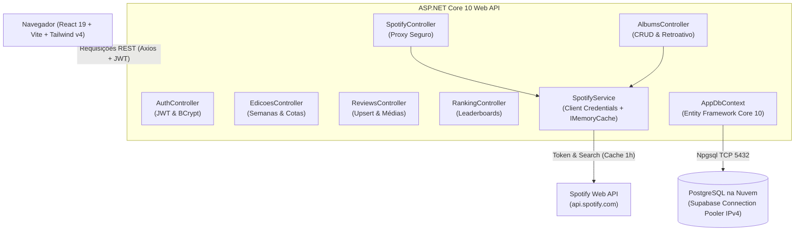

# 📖 Documentação Técnica & Arquitetural — Clube do Álbum

Esta documentação serve como referência técnica completa para desenvolvedores, arquitetos e mantenedores do projeto **Clube do Álbum**. Ela detalha o histórico de decisões, as razões arquiteturais por trás de cada escolha, a estrutura de diretórios e arquivos, e o funcionamento das regras de negócio.

---

## 📑 Índice
1. [Visão Geral & Contexto de Negócio](#1-visão-geral--contexto-de-negócio)
2. [Linha do Tempo do Desenvolvimento](#2-linha-do-tempo-do-desenvolvimento)
3. [Decisões de Arquitetura & Justificativas Técnicas](#3-decisões-de-arquitetura--justificativas-técnicas)
4. [Regras de Negócio do Clube](#4-regras-de-negócio-do-clube)
5. [Estrutura Completa de Diretórios e Arquivos](#5-estrutura-completa-de-diretórios-e-arquivos)
6. [Catálogo de Endpoints da API REST](#6-catálogo-de-endpoints-da-api-rest)
7. [Guia de Manutenção, Execução e Deploy](#7-guia-de-manutenção-execução-e-deploy)

---

## 1. Visão Geral & Contexto de Negócio

O **Clube do Álbum** é uma iniciativa entre amigos (~10 membros) dedicada à audição semanal de álbuns musicais completos (com ênfase em Heavy Metal, Rock e vertentes), seguida de encontros periódicos para debate e atribuição de notas.

### O Problema Original
Historicamente, o clube utilizava planilhas manuais (Google Sheets/Excel) para controlar:
- Quais discos já foram ouvidos;
- Quem indicou cada disco;
- As notas individuais dadas por cada membro (de 0.0 a 10.0);
- O ranking geral ordenado pela média aritmética;
- O ranking de curadores (quem recomenda os melhores e os piores discos).

**Dores do modelo antigo:**
- Risco de perda de dados e sobreposição acidental de células;
- Dificuldade para verificar capas, anos de lançamento e links oficiais do Spotify;
- Falta de histórico visual e identidade temática;
- Processo manual e demorado de consolidação de médias e tabelas dinâmicas.

### A Solução
Uma plataforma web completa com:
- Interface moderna estilo **Letterboxd / RateYourMusic**, com estética escura sóbria e elegante;
- Integração nativa com a **API do Spotify** para busca inteligente de metadados e capas;
- Validação automática de regras (ex: cotas de até 2 indicações por membro por semana);
- Gestão de semanas temáticas (*Edições*);
- Cálculo automático de médias com selos de classificação bem-humorados;
- Suporte a migração de dados históricos retroativos da planilha.

---

## 2. Linha do Tempo do Desenvolvimento

A construção do projeto seguiu uma abordagem evolutiva, dividida em fases estratégicas:

### Fase 1: Modelagem Relacional & Setup do Backend (.NET 10)
- Criação da solução `ClubeDoAlbum.Api` utilizando .NET 10 Web API com Entity Framework Core.
- Modelagem das quatro entidades relacionais principais: `User`, `Edicao`, `Album` e `Avaliacao`.
- Configuração do PostgreSQL hospedado na nuvem pelo Supabase.

### Fase 2: O Desafio de Conectividade do Supabase (IPv6 vs IPv4)
- **Problema encontrado:** A conexão direta padrão do Supabase (`db.<ref>.supabase.co:5432`) resolve exclusivamente endereços IPv6 (`AAAA`). Como muitos provedores de internet e redes domésticas no Brasil não possuem roteamento IPv6 nativo ativo, as requisições do EF Core resultavam em `SocketException: No such host is known`.
- **Solução implementada:** Migração da string de conexão para o **Connection Pooler do Supabase** (`aws-1-sa-east-1.pooler.supabase.com:5432`). O pooler disponibiliza registros IPv4 (`A`) na mesma região da AWS em São Paulo, garantindo latência ultrabaixa (~65ms) e estabilidade de conexão.

### Fase 3: Segurança no Banco com Row Level Security (RLS)
- O Supabase expõe por padrão uma API pública PostgREST. Para garantir que ninguém pudesse manipular o banco sem passar pela nossa API .NET, habilitamos políticas de **Row Level Security (RLS)** em todas as tabelas. Como a nossa API conecta utilizando o usuário administrador `postgres`, ela opera acima das restrições de RLS com total segurança.

### Fase 4: Integração com a API do Spotify
- Obtenção e configuração das credenciais `ClientId` e `ClientSecret` no `appsettings.json`.
- Implementação do `SpotifyService.cs` utilizando o fluxo **Client Credentials Flow**:
  - Requisição de token de autenticação via endpoint oficial `https://accounts.spotify.com/api/token`;
  - Cache em memória via `IMemoryCache` (tempo de expiração de 1 hora) para evitar requisições repetidas de token;
  - Parser inteligente com Regex para extrair o ID do álbum a partir de links (`open.spotify.com/album/{id}`);
  - Endpoint de busca textual com múltiplas opções para seleção no frontend.

### Fase 5: Refinamento das Regras de Negócio & Tiers Temáticos
- Ajuste do status dos álbuns para um modelo direto e sem ruídos: apenas `EstaSemana` e `JaOuvido`.
- Criação do `ClassificacaoNotaHelper.cs` com os tiers característicos do clube:
  - `8.0 a 10.0`: **Masterpiece**
  - `7.0 a 7.9`: **É o Aço**
  - `6.0 a 6.9`: **Bom**
  - `4.0 a 5.9`: **Meia Boca**
  - `2.0 a 3.9`: **Ruim**
  - `0.0 a 1.9`: **Absolute Porcaria**
- Criação do endpoint `/api/albums/retroativo` para permitir importar o acervo antigo de reuniões diretamente da planilha com notas em lote, sem passar pela semana atual.

### Fase 6: Criação do Frontend (React + Vite + Tailwind CSS v4)
- Setup do projeto `ClubeDoAlbum.Web` com Vite 8, React 19, TypeScript e o novo compilador do Tailwind CSS v4.
- Criação de todas as páginas:
  - `HomePage`: Hero em formato de disco de vinil giratório, destaque da semana, cotas dos membros e Top 3.
  - `AlbumDetailPage`: Visualização detalhada, capa em alta resolução, controle interativo de nota (0.0 a 10.0 com stepper numérico e slider contínuo) e feed de resenhas dos amigos.
  - `RankingPage`: "O Grande Ranking" com pódio visual (#1, #2, #3) e tabela com filtros por tier.
  - `CuratorsPage`: "Hall da Fama" (melhores curadores) e "Troféu Podrinho" (piores curadores).
  - `CatalogPage`: Acervo com filtros combinados de busca, curador, classificação e ordenação.
  - `MyReviewsPage`: Diário pessoal de avaliações com edição em tempo real de notas e comentários.
  - `ProfilePage`: Configurações do membro (avatar, nome, senha).
  - `EdicoesPage`: Arquivo de todas as edições anteriores, temas, vencedores da semana e médias.

### Fase 7: Suporte a Múltiplos Álbuns & Semanas Temáticas
- Adaptação da regra do clube: cada membro pode indicar **até 2 álbuns por semana temática** (podendo somar 10 álbuns com 5 membros ativos).
- Criação do `EdicoesController.cs` com endpoints para criar temas de semanas, ativá-los e encerrá-los.
- Criação do `CreateEdicaoModal.tsx` para cadastro de novas rodadas.
- Criação da barra de acompanhamento de indicações na Home (`MembroIndicacoesStatusDto`), informando em tempo real quem já enviou 2/2, 1/2 ou 0/2 álbuns.

### Fase 8: Mecanismo de Busca Inteligente no Spotify
- Evolução da busca no modal `+ Indicar Disco`: agora, ao digitar termos gerais como `"Metallica"` ou `"Opeth"`, a aplicação retorna até 10 álbuns compatíveis com capas, anos e artistas para seleção interativa com um clique.

### Fase 9: Correção de Bug de Isolamento de Edições
- **Diagnóstico:** Quando uma nova edição ativa era criada, álbuns de edições anteriores permaneciam com `Status == EstaSemana`, poluindo a contagem de cotas de membros e a exibição da semana ativa.
- **Correção:** Implementação de isolamento estrito no backend:
  - A cota da semana ativa filtra estritamente por `a.EdicaoId == edicaoAtiva.Id && a.Status == EstaSemana`.
  - Ao criar uma nova semana ativa ou finalizar uma existente, todos os álbuns de edições anteriores são automaticamente transicionados para `JaOuvido`.

### Fase 10: Redesign Visual de Alta Fidelidade & Design System (Estilo Lambda.ai & Claude Code)
- Reformulação visual profunda de ponta a ponta sem alterar qualquer regra de negócio ou endpoint existente:
  - **Fundo Atmosférico em Vapour/Mist Dinâmico:** Componente GPU-accelerated em HTML5 Canvas (`VapourBackground.tsx`) com nuvens de fumaça etérea, partículas de cinza/brasas em suspensão e reação suave aos movimentos do cursor do usuário, combinado com grid sutil e vinheta radial.
  - **Lettering em Levitação Atmosférica:** Títulos em alta resolução utilizando `Space Grotesk`, `Plus Jakarta Sans` e `JetBrains Mono`, com animação de flutuação suave (`vapour-float`), gradiente cromático reflexivo (`text-shimmer`) e brilho difuso.
  - **Tokens de Produto & Glassmorphism:** Painéis com superfície fosca de vidro (`backdrop-blur-xl`), bordas de precisão capilar (`border-white/[0.08]`) e iluminação interna chanfrada (`inset 0 1px 0 rgba(255,255,255,0.08)`).
  - **Vinil Realista & Equalizador Sonoro:** Ranhuras de vinil com reflexo anular de luz (`vinyl-grooves`), rotação mecânica em hover e animação de ondas sonoras de frequência (`SoundwaveVisualizer.tsx`).
  - **Selos e Badges de Joalheria:** Redesenho completo do `TierBadge.tsx` com micro-indicadores luminosos pulsantes para cada uma das 6 faixas temáticas (*Masterpiece*, *É o Aço*, *Bom*, *Meia Boca*, *Ruim*, *Absolute Porcaria*).

### Fase 11: Correção na Contagem de Avaliações das Edições
- **Diagnóstico:** Ao retornar da página de detalhes após salvar uma nota, o álbum da semana na landing page voltava a exibir "Aguardando as primeiras avaliações da rodada!".
- **Causa Raiz:** O endpoint `GET /api/edicoes/ativa` (e `GetAllEdicoes`) carregava os álbuns vinculados sem incluir a relação `.Include(e => e.Albuns).ThenInclude(a => a.Avaliacoes)`. Consequentemente, `a.Avaliacoes` vinha `null` e o DTO mapeava `TotalAvaliacoes = 0`.
- **Solução Aplicada:**
  - Inclusão de `.Include(e => e.Albuns).ThenInclude(a => a.Avaliacoes)` em todos os métodos de consulta do `EdicoesController.cs`.
  - Atualização no frontend para considerar a nota calculada `(destaque.totalAvaliacoes > 0 || destaque.notaMedia > 0)` e sincronizar `albunsSemana` com as avaliações recém-registradas.

---

## 3. Decisões de Arquitetura & Justificativas Técnicas



### 3.1. Por que ASP.NET Core (.NET 10)?
- **Performance de Nível Empresarial:** O runtime do .NET está entre os mais velozes do mundo em benchmarks web (TechEmpower).
- **Tipagem Estrita e Confiabilidade:** Elimina erros comuns de tipagem em tempo de compilação.
- **Injeção de Dependência Nativa:** O container nativo do ASP.NET Core gerencia ciclo de vida de `HttpClient`, `DbContext` e serviços com limpeza automática de conexões.

### 3.2. Proxy do Spotify no Backend (Por que não chamar direto no React?)
- **Segurança Absoluta do Client Secret:** Se chamássemos o Spotify diretamente no navegador do usuário, o `ClientSecret` da nossa aplicação estaria exposto no código JavaScript compilado, permitindo que qualquer pessoa roubasse as credenciais.
- **Economia de Cotas e Latência (IMemoryCache):** O token de acesso do Spotify dura 1 hora. O backend armazena o token em cache e o reutiliza para todas as requisições de todos os membros, minimizando chamadas externas e prevenindo bloqueios por *Rate Limit*.

### 3.3. Autenticação Stateless com JWT e BCrypt
- **JWT (JSON Web Token):** A API é puramente stateless (sem sessão em memória no servidor), permitindo que o backend escale horizontalmente ou rode em contêineres sem depender de sessões sticky.
- **BCrypt:** Senhas de membros nunca são salvas em texto puro; são protegidas com algoritmos de hash com *salt* criptográfico contra ataques de dicionário e *rainbow tables*.

### 3.4. PostgreSQL no Supabase com Pooler IPv4
- **Dados Relacionais Consistentes:** Integridade referencial com chaves estrangeiras entre `users`, `edicoes`, `albums` e `avaliacoes`.
- **Connection Pooler IPv4:** Evita limitações de rede locais de provedores brasileiros sem suporte pleno a IPv6.

### 3.5. Frontend com Vite + Tailwind CSS v4
- **Vite 8:** Compilação em milissegundos via esbuild e Rollup, garantindo experiência de desenvolvimento extremamente fluida.
- **Tailwind CSS v4:** Motor moderno de CSS que gera apenas as classes utilizadas na produção, com tamanho final de CSS inferior a 60 KB.

---

## 4. Regras de Negócio do Clube

### 4.1. Escala de Notas e Classificação
Toda nota deve ser um valor decimal entre **0.0 e 10.0** com precisão de uma casa decimal (ex: `8.5`, `9.2`). As faixas de classificação são calculadas dinamicamente:

| Faixa de Nota | Classificação | Tom Visual | Significado |
|---|---|---|---|
| **8.0 a 10.0** | **Masterpiece** | Dourado metálico | Obra-prima indiscutível, essencial para o gênero |
| **7.0 a 7.9** | **É o Aço** | Verde esmeralda | Disco excelente, pesado, sem gorduras |
| **6.0 a 6.9** | **Bom** | Azul aço | Disco sólido, vale a audição completa |
| **4.0 a 5.9** | **Meia Boca** | Cinza zinco | Mediano, tem momentos bons mas derrapa |
| **2.0 a 3.9** | **Ruim** | Laranja queimado | Fraco, produção questionável ou canções descartáveis |
| **0.0 a 1.9** | **Absolute Porcaria** | Carmesim escuro | Desastre sonoro, bomba total |

### 4.2. Status do Álbum e da Edição
- **Status do Álbum:**
  - `EstaSemana`: O disco está na rodada ativa e os membros devem ouvi-lo e avaliá-lo.
  - `JaOuvido`: O disco já passou pelo debate do clube e agora reside permanentemente no catálogo histórico e nos rankings.
- **Status da Edição (Semana Temática):**
  - `Planejada`: Tema cadastrado para o futuro.
  - `EmAndamento`: Edição ativa corrente. Todos os álbuns adicionados na semana associam-se a ela.
  - `Finalizada`: Rodada encerrada; todos os discos que pertenciam a ela são arquivados como `JaOuvido`.

### 4.3. Regra de Cotas de Indicação
- Cada membro ativo tem direito a indicar **no máximo 2 álbuns por semana temática ativa**.
- O backend valida a quantidade de álbuns vinculados ao ID do membro para aquela edição ativa:
  $$\text{Total Indicados} = \text{Count}(\text{EdicaoId} = \text{Ativa} \land \text{UserId} = \text{Membro} \land \text{Status} = \text{EstaSemana})$$
- Se o valor for $\ge 2$, a API bloqueia a requisição retornando `HTTP 400 Bad Request`.
- O frontend exibe indicadores de progresso (`0/2`, `1/2`, `2/2` com selo verde de concluído).

### 4.4. Recálculo Imediato de Médias (Upsert)
- Cada membro só pode avaliar uma única vez o mesmo álbum (garantido por restrição única no banco: `UNIQUE(AlbumId, UserId)`).
- Se o membro enviar uma nova nota para um disco que já avaliou, o sistema atualiza a nota existente.
- A cada avaliação criada ou editada, a média aritmética do álbum é recalculada instantaneamente:
  $$\text{NotaMedia} = \text{Round}\left(\frac{\sum \text{Notas}}{N}, 1\right)$$

### 4.5. Leaderboards
- **O Grande Ranking:** Lista álbuns ordenados por `NotaMedia DESC`.
- **Ranking de Curadores (Hall da Fama vs Troféu Podrinho):**
  - Calcula a média das notas de todos os álbuns indicados por cada membro:
    $$\text{MediaCurador} = \frac{\sum \text{NotaMedia dos Discos Indicados pelo Membro}}{\text{Total de Discos Indicados}}$$
  - Identifica o melhor e o pior disco de cada curador para alimentar as premiações da rodada.

---

## 5. Estrutura Completa de Diretórios e Arquivos

### 5.1. Backend (`ClubeDoAlbum.Api`)

```
ClubeDoAlbum.Api/
├── Common/
│   └── ClassificacaoNotaHelper.cs      # Mapeia notas numéricas (0.0 - 10.0) para os 6 tiers textuais
├── Controllers/
│   ├── AlbumsController.cs             # CRUD de álbuns, busca, cadastro retroativo e validação de cotas
│   ├── AuthController.cs               # Registro, login JWT, dados do usuário logado e alteração de perfil/senha
│   ├── EdicoesController.cs            # Gestão de semanas temáticas, encerramento de rodadas e cotas dos membros
│   ├── RankingController.cs            # Leaderboards de álbuns e ranking de curadores (Hall da Fama / Podrinho)
│   ├── ReviewsController.cs            # Criação, edição de avaliações, recálculo de médias e diário pessoal
│   └── SpotifyController.cs            # Proxy seguro para busca e resolução de álbuns via Spotify API
├── Data/
│   └── AppDbContext.cs                 # Configuração do EF Core, mapeamento de tabelas, índices únicos e conversões de enums
├── DTOs/
│   ├── AlbumDtos.cs                    # Contratos de transferência para criação e retorno de álbuns
│   ├── AuthDtos.cs                     # Contratos para autenticação, atualização de perfil e senha
│   ├── EdicaoDtos.cs                   # Contratos para semanas temáticas e tracking de cotas
│   ├── RankingDtos.cs                  # Contratos para tabelas de rankings e estatísticas de curadores
│   └── ReviewDtos.cs                   # Contratos para avaliações e histórico individual
├── Models/
│   ├── Entities/
│   │   ├── Album.cs                    # Entidade Álbum (SpotifyId, Título, Artista, Capa, Status, NotaMedia)
│   │   ├── Avaliacao.cs                # Entidade Avaliação (Nota, Comentário, Data, Relação Álbum/Usuário)
│   │   ├── Edicao.cs                   # Entidade Edição/Semana (Tema, Número, DataReunião, Status)
│   │   └── User.cs                     # Entidade Usuário (Nome, Email, SenhaHash, AvatarUrl, IsAdmin)
│   └── Enums/
│       ├── AlbumStatus.cs              # Enum: EstaSemana, JaOuvido
│       └── EdicaoStatus.cs             # Enum: Planejada, EmAndamento, Finalizada
├── Services/
│   ├── Auth/
│   │   ├── ITokenService.cs            # Interface de geração de tokens JWT
│   │   └── TokenService.cs             # Implementação da assinatura e claims JWT (30 dias)
│   └── Spotify/
│       ├── ISpotifyService.cs          # Interface de comunicação com o Spotify
│       ├── SpotifyService.cs           # Implementação com Client Credentials, cache de token e busca
│       └── SpotifySettings.cs          # Mapeamento do ClientId e ClientSecret do appsettings.json
├── Properties/
│   └── launchSettings.json             # Perfis de inicialização (porta 5046)
├── Program.cs                          # Ponto de entrada, configuração de middlewares, CORS, DI e JWT Bearer
├── appsettings.json                    # Strings de conexão, chaves JWT e credenciais do Spotify
└── ClubeDoAlbum.Api.csproj             # Arquivo de projeto .NET 10 e dependências NuGet
```

### 5.2. Frontend (`ClubeDoAlbum.Web`)

```
ClubeDoAlbum.Web/
├── src/
│   ├── components/
│   │   ├── AddAlbumModal.tsx           # Modal duplo: Indicação para a semana (com cota) ou Cadastro Retroativo
│   │   ├── AlbumCard.tsx               # Card estilo Letterboxd com capa, selo de nota e efeito hover
│   │   ├── CreateEdicaoModal.tsx       # Modal para cadastro de novas semanas temáticas e regras
│   │   ├── Navbar.tsx                  # Barra de navegação responsiva em vidro fosco com atalhos e menu
│   │   ├── ScoreInput.tsx              # Componente tátil com slider contínuo, steppers e nota /10
│   │   ├── SoundwaveVisualizer.tsx     # Equalizador estético de ondas sonoras e frequência musical
│   │   ├── TierBadge.tsx               # Selo de joalheria com micro-pips luminosos por faixa de nota
│   │   └── VapourBackground.tsx        # Fundo dinâmico GPU-canvas com fumaça etérea e partículas reativas ao mouse
│   ├── context/
│   │   └── AuthContext.tsx             # Contexto global de autenticação (usuário logado, token, login, logout)
│   ├── pages/
│   │   ├── AlbumDetailPage.tsx         # Página de detalhes, curador destacado, player Spotify e reviews dos amigos
│   │   ├── CatalogPage.tsx             # Catálogo de álbuns com busca instantânea e filtros por curador e tier
│   │   ├── CuratorsPage.tsx            # Leaderboard de curadores com toggle Hall da Fama / Troféu Podrinho
│   │   ├── EdicoesPage.tsx             # Arquivo de edições temáticas passadas, vencedores e rodada ativa
│   │   ├── HomePage.tsx                # Tela principal: disco no vinil, vitrine da semana e cotas da galera
│   │   ├── LoginPage.tsx               # Formulário de autenticação
│   │   ├── MyReviewsPage.tsx           # Diário de avaliações do membro com edição in-place
│   │   ├── ProfilePage.tsx             # Edição de dados cadastrais, avatar e redefinição de senha
│   │   └── RegisterPage.tsx            # Cadastro de novos membros do clube
│   ├── services/
│   │   └── api.ts                      # Instância do Axios com interceptor de JWT e chamadas à API
│   ├── types/
│   │   └── index.ts                    # Definições de tipos TypeScript compartilhadas em toda a aplicação
│   ├── App.tsx                         # Definição de rotas do React Router e modais globais
│   ├── index.css                       # Importação do Tailwind CSS v4 e estilizações de animação
│   └── main.tsx                        # Ponto de montagem da aplicação React no DOM
├── index.html                          # Template HTML com fontes e metatags
├── package.json                        # Dependências npm e scripts de build
├── tsconfig.json                       # Configuração do TypeScript
└── vite.config.ts                      # Configuração do Vite com plugin do Tailwind CSS v4
```

---

## 6. Catálogo de Endpoints da API REST

A API escuta por padrão em `http://localhost:5046/api`.

### 6.1. Autenticação & Membros (`/api/auth`)
- `POST /api/auth/register`: Cadastra um novo membro. O primeiro usuário cadastrado torna-se administrador automaticamente.
- `POST /api/auth/login`: Valida email/senha e retorna o token JWT e dados do membro.
- `GET /api/auth/me` *(Requer JWT)*: Retorna os dados do membro logado.
- `PUT /api/auth/profile` *(Requer JWT)*: Atualiza o nome de exibição e link do avatar.
- `PUT /api/auth/password` *(Requer JWT)*: Altera a senha do membro logado com validação da senha atual.
- `GET /api/auth/users`: Lista todos os membros cadastrados no clube (para dropdowns de curadoria).

### 6.2. Semanas Temáticas & Edições (`/api/edicoes`)
- `GET /api/edicoes`: Lista todas as edições anteriores e ativas com seus respectivos discos e notas.
- `GET /api/edicoes/ativa`: Retorna a edição temática atualmente em andamento (ou `null` se não houver).
- `GET /api/edicoes/ativa/membros-status`: Retorna em tempo real quantas indicações cada membro já realizou na semana ativa (cota `0/2`, `1/2` ou `2/2`).
- `POST /api/edicoes`: Cria uma nova semana temática. Se `ativarImediatamente = true`, encerra a semana anterior e passa seus discos para `JaOuvido`.
- `POST /api/edicoes/{id}/encerrar`: Finaliza a rodada da semana e arquiva seus discos como ouvidos.
- `POST /api/edicoes/{id}/ativar`: Ativa uma edição existente como a rodada da semana.

### 6.3. Álbuns (`/api/albums`)
- `GET /api/albums?status={status}&edicaoId={id}&userId={id}`: Lista álbuns com filtros opcionais. Quando filtrado por `status=EstaSemana`, respeita a edição ativa.
- `GET /api/albums/{id}`: Retorna os detalhes completos de um álbum, notas de todos os membros e resenhas.
- `POST /api/albums`: Indica um novo álbum para a semana ativa. Valida duplicatas, busca metadados no Spotify e valida a cota de 2 indicações do membro.
- `POST /api/albums/retroativo`: Importa dados históricos em lote com notas de múltiplos membros direto para o acervo histórico.
- `PATCH /api/albums/{id}/status`: Altera manualmente o status do álbum (`EstaSemana` $\leftrightarrow$ `JaOuvido`).
- `DELETE /api/albums/{id}`: Remove um álbum do acervo (e suas avaliações em cascata).

### 6.4. Avaliações & Resenhas (`/api/reviews`)
- `POST /api/reviews`: Cria ou atualiza a nota (0.0 a 10.0) e resenha de um membro para um álbum, recalculando a média imediatamente.
- `GET /api/reviews/album/{albumId}`: Lista todas as avaliações de um álbum específico.
- `GET /api/reviews/user/{userId}`: Retorna o diário completo de discos avaliados por um membro.

### 6.5. Leaderboards & Rankings (`/api/ranking`)
- `GET /api/ranking?apenasAvaliados=true`: Retorna a lista de todos os discos ouvidos ordenados da maior nota para a menor.
- `GET /api/ranking/curators?ordem=desc`: Retorna o ranking de curadores (*Hall da Fama* se `desc`, *Troféu Podrinho* se `asc`).

### 6.6. Proxy do Spotify (`/api/spotify`)
- `GET /api/spotify/search?query={texto}&limit=10`: Retorna até N opções de álbuns do Spotify com capas e anos.
- `GET /api/spotify/resolve?input={linkOuNome}`: Resolve um álbum único via link direto ou texto.
- `GET /api/spotify/album/{id}`: Consulta dados de um álbum diretamente pelo Spotify ID.

---

## 7. Guia de Manutenção, Execução e Deploy

### 7.1. Execução Local
1. **Iniciar a API:**
   ```powershell
   cd ClubeDoAlbum.Api
   dotnet run --launch-profile http
   ```
2. **Iniciar o Frontend:**
   ```powershell
   cd ClubeDoAlbum.Web
   npm run dev
   ```

### 7.2. Compilação para Produção
- **Backend:**
  ```powershell
  cd ClubeDoAlbum.Api
  dotnet publish -c Release -o ./publish
  ```
- **Frontend:**
  ```powershell
  cd ClubeDoAlbum.Web
  npm run build
  ```
  Os arquivos estáticos otimizados serão gerados na pasta `dist/`.

### 7.3. Diretrizes de Deploy
- **Backend (.NET API):** Pode ser hospedado gratuitamente ou a baixo custo em plataformas como **Render**, **Railway** ou **Fly.io** utilizando contêiner Docker. Basta configurar as variáveis de ambiente equivalentes ao `appsettings.json` (`ConnectionStrings__DefaultConnection`, `Spotify__ClientId`, `Spotify__ClientSecret`, `Jwt__Key`).
- **Frontend (SPA React):** Pode ser hospedado gratuitamente na **Vercel**, **Cloudflare Pages** ou **Netlify**, apontando a variável de ambiente `VITE_API_URL` para o endereço da API em produção.
- **Banco de Dados:** O Supabase já está em nuvem com alta disponibilidade na AWS São Paulo (`sa-east-1`).
